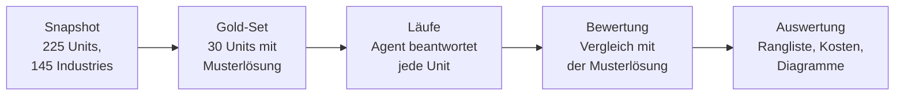

# Benchmark-Mapping

**Wie gut ordnen KI-Agents Ausschüsse des US-Kongresses den richtigen Branchen zu?**

Dieses Projekt ist ein lokaler Benchmark. Es lässt die KI-Agents Claude Code, Codex und OpenCode dieselbe Aufgabe lösen, vergleicht ihre Antworten mit einer von Hand geprüften Musterlösung und zeigt in einer Web-App, welcher Agent am besten, günstigsten und schnellsten ist.

Offene Aufgaben stehen in der [TODO-Liste](TODO.md), technische Details in der [technischen Referenz](docs/technik.md).

## Die Aufgabe an einem Beispiel

Jeder Ausschuss (im Projekt **Unit** genannt) hat einen Zuständigkeitstext. Der Agent liest ihn und nennt die passenden Branchen (**Industries**) aus einer festen Liste von 145 Einträgen, jeweils mit einem wörtlichen Zitat als Beleg.

| Unit | Zuständigkeit (gekürzt) | Mögliche Antwort |
| --- | --- | --- |
| House Agriculture – Livestock, Dairy and Poultry | Viehzucht, Milch, Geflügel … | `farm-products`, `food-distribution` |
| House Ethics | Verhaltensregeln der Abgeordneten | keine Branche (`no_mapping`) |

Auch „keine Branche“ kann die richtige Antwort sein.

## So funktioniert es



1. **Snapshot**: ein eingefrorener Datenstand aller Units und Industries. Er liegt im Repository und ändert sich nicht.
2. **Gold-Set**: Du wählst bis zu 30 Units aus und legst je Unit fest, welche Branchen richtig sind. Dabei helfen Vorschläge mehrerer Agents. Das Ergebnis wird als `gold-v1` eingefroren.
3. **Lauf**: Ein Agent mit festen Einstellungen (Harness, Modell, Effort, mit oder ohne Websuche) beantwortet alle Units des Gold-Sets.
4. **Bewertung**: Jede Antwort bekommt einen Score zwischen 0 und 1. Wer richtige Branchen vergisst oder falsche nennt, verliert Punkte.
5. **Auswertung**: Rangliste, Kosten-Score-Diagramm, Heatmap und Verlauf zeigen die Läufe im Vergleich.

## Schnellstart

Voraussetzungen: Linux oder macOS, Node 24, pnpm 11, Docker mit Compose v2 und mindestens eine angemeldete Agent-CLI (`claude`, `codex` oder `opencode`).

```sh
pnpm install   # einmalig: Abhängigkeiten installieren
pnpm app       # Datenbank, App und Worker starten: http://127.0.0.1:3000
```

`pnpm app` startet die Datenbank, bereitet sie vor und startet dann die App zusammen mit dem Worker. Der Worker führt die Läufe aus, die du in der App anlegst. Strg+C beendet App und Worker gemeinsam; endet einer der beiden unerwartet, wird der andere ebenfalls beendet. Die Datenbank läuft weiter (`docker compose stop` beendet sie).

Einstellungen für den Worker trägst du einmalig in eine Datei `.env.local` im Projektordner ein (Pfade absolut, ohne `~`; gilt für `pnpm app`), zum Beispiel:

```sh
CODEX_AUTH_HOME=/home/<du>/.codex-b
OPENCODE_WEBSEARCH_PROVIDER=exa
```

## Sicherheit

Die App hat keine Anmeldung. Jeder, der sie erreicht, kann Agent-Läufe starten, die auf dein Abo oder deinen API-Schlüssel laufen. App und Datenbank binden deshalb nur an `127.0.0.1`. Die Datenbank nutzt das lokale Standardpasswort aus `docker-compose.yml`.

- Binde die App nicht an `0.0.0.0` und stelle sie nicht hinter einen öffentlichen Proxy.
- Zugangsdaten gehören nur in `.env.local`. Die Datei ist per `.gitignore` ausgeschlossen.
- Die Agents laufen in temporären Arbeitsverzeichnissen mit einer Positivliste an Umgebungsvariablen. Sie sind trotzdem nicht vollständig vom System getrennt. Starte Läufe nur auf einem Rechner, dem du diese CLIs ohnehin anvertraust.

## Die Seiten der App

| Seite | Wofür |
| --- | --- |
| `/gold` | Gold-Set zusammenstellen, Vorschläge prüfen, Version einfrieren |
| `/laeufe` | Läufe anlegen, Fortschritt verfolgen, abbrechen oder fortsetzen |
| `/auswertung` | Rangliste, Kosten-Score-Diagramm, Score je Kategorie, Heatmap, Verlauf |
| `/modelle` | Preise je Modell und Websuche pflegen |
| `/prompt` | Den genauen Text ansehen, den die Agents bekommen |
| `/snapshot` | Alle Units und Industries des Datenstands |

## Wie bewertet wird

- Die Musterlösung teilt Branchen in **positiv** (muss genannt werden) und **vertretbar** (darf genannt werden, höchstens 2 je Unit).
- Der Score einer Unit verbindet zwei Fragen: Wurden alle positiven Branchen gefunden? Und sind die genannten Branchen richtig?
- Der Score eines Laufs ist der Mittelwert aller Units, mit einem Unsicherheitsbereich.
- Eine Antwort im falschen Format zählt 0. In der Heatmap ist sie trotzdem als Format-Fehler erkennbar und nicht mit einer falschen Zuordnung zu verwechseln.
- Verglichen werden nur Läufe mit demselben Prompt, demselben Datenstand und demselben Modus.

## Kosten

Die App schätzt die Kosten jedes Laufs zum API-Listenpreis: Tokens mal Preis, dazu die Websuchen. Das gilt auch, wenn du über ein Abo bezahlst. So lassen sich alle Agents fair vergleichen. Fehlt ein Preis, zeigt die App „unbekannt“ statt 0 $. Die Preise pflegst du unter `/modelle`.

## Tests

```sh
pnpm check      # Formatierung, Typen, Unit-Tests
pnpm test:e2e   # Browser-Tests in einer eigenen Test-Datenbank (Datenbank muss laufen)
```

Vor dem ersten Browser-Test einmal `pnpm exec playwright install chromium` ausführen.

## Mehr dazu

- [Technische Referenz](docs/technik.md): Ports, Import, Prompt, Kosten, Agents, Auswertung und Tests im Detail
- [Glossar](GLOSSARY.md): alle Fachbegriffe
- [Architekturentscheidungen](docs/adr/)
- [Gold-Kandidaten](docs/goldset/kandidaten.md) und [Recherche zur Kostenerfassung](docs/research/)
- Planung und Tickets: [GitHub Issues](https://github.com/Bene77-w/Benchmark-Mapping/issues); Arbeitsablauf für Agents: [AGENTS.md](AGENTS.md)

Die Aufgabe stammt aus dem Committee Matcher des Congress Trackers.

## Lizenz

[MIT](LICENSE). Übernommene Agent-Skills und Datenquellen mit ihren Lizenzen stehen in [THIRD_PARTY_NOTICES.md](THIRD_PARTY_NOTICES.md).
