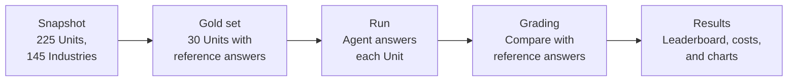

# Benchmark-Mapping

How accurately can AI agents map U.S. congressional committees to industries?

This local benchmark gives Claude Code, Codex, and OpenCode the same task and grades their answers against a manually reviewed reference set. The web app compares accuracy, estimated cost, and runtime.

See the [TODO list](TODO.md) for open work and the [technical reference](docs/technik.md) for implementation details.

## Mapping task

Each committee or subcommittee is a **Unit** with a jurisdiction statement. An agent reads that statement, selects applicable **Industries** from a fixed list of 145 entries, and supports each selection with a direct quote.

| Unit | Jurisdiction (abridged) | Possible answer |
| --- | --- | --- |
| House Agriculture – Livestock, Dairy and Poultry | Livestock, dairy, poultry … | `farm-products`, `food-distribution` |
| House Ethics | Rules of conduct for House members | No applicable industry (`no_mapping`) |

## Benchmark workflow



1. **Snapshot.** The repository contains a frozen copy of all Units and Industries.
2. **Gold set.** Select up to 30 Units, review suggestions from multiple agents, and decide which industries apply. Freeze the result as `gold-v1`.
3. **Run.** One agent answers every Unit in the gold set using a fixed harness, model, effort level, and web search setting.
4. **Grading.** Each answer receives a score from 0 to 1. Missing required industries and including incorrect ones both reduce the score.
5. **Results.** Compare runs using the leaderboard, cost-versus-score plot, heatmap, and history.

## Quick start

You need Linux or macOS, Node.js 24, pnpm 11, Docker with Compose v2, and at least one authenticated agent CLI (`claude`, `codex`, or `opencode`).

```sh
pnpm install   # Install dependencies once
pnpm app       # Start the database, app, and worker at http://127.0.0.1:3000
```

`pnpm app` starts and prepares the database, then launches the app and the worker. The worker executes runs you create in the app. Ctrl+C stops both processes. If either process exits unexpectedly, the other stops as well. The database keeps running until you run `docker compose stop`.

Set worker options for `pnpm app` in a local `.env.local` file at the repository root. Use absolute paths without `~`.

```sh
CODEX_AUTH_HOME=/home/<user>/.codex-b
OPENCODE_WEBSEARCH_PROVIDER=exa
```

## Security

The app has no login. Anyone who can reach it can start agent runs using your subscription or API key. The app and database both bind to `127.0.0.1`. The database uses the local default password from `docker-compose.yml`.

- Keep the app on loopback and off public proxies.
- Store credentials in `.env.local`, which Git ignores.
- Agents run in temporary working directories and receive only allowlisted environment variables. They still have access to parts of the host, so run the benchmark on a machine where you already trust the agent CLIs.

## App pages

| Path | Purpose |
| --- | --- |
| `/gold` | Build the gold set, review suggestions, and freeze a version |
| `/laeufe` | Create runs, track progress, cancel, or resume |
| `/auswertung` | View the leaderboard, cost-versus-score plot, scores by category, heatmap, and history |
| `/modelle` | Maintain model and web search prices |
| `/prompt` | Read the exact prompt sent to agents |
| `/snapshot` | Browse all Units and Industries in the snapshot |

## Scoring

- The reference answer classifies industries as **positive** (required) or **acceptable** (optional, up to two per Unit).
- The Unit score combines how many required industries the agent found with how many of its selections were correct.
- The run score is the mean across Units and includes an uncertainty interval.
- An answer in the wrong format scores zero. The heatmap labels it as a format error.
- Run comparisons require the same prompt, snapshot, and mode.

## Cost estimates

The app uses API list prices to estimate token and web search costs for every run, including runs paid through a subscription. Missing prices appear as unknown. Edit prices at `/modelle`.

## Tests

```sh
pnpm check      # Formatting, type checks, and unit tests
pnpm test:e2e   # Browser tests against a separate test database
```

Keep the database running for browser tests. Before the first browser test, run `pnpm exec playwright install chromium`.

## Further reading

- [Technical reference](docs/technik.md) covers ports, import, prompts, costs, agents, results, and tests.
- [Glossary](GLOSSARY.md) and [architecture decisions](docs/adr/)
- [Gold-set candidates](docs/goldset/kandidaten.md) and [cost tracking research](docs/research/)
- [GitHub Issues](https://github.com/Bene77-w/Benchmark-Mapping/issues) for planning and tickets, and [AGENTS.md](AGENTS.md) for the agent workflow

The benchmark task comes from the Congress Trade Tracker's Committee Matcher.

## License

[MIT](LICENSE). See [THIRD_PARTY_NOTICES.md](THIRD_PARTY_NOTICES.md) for the licenses of bundled agent skills and data sources.
